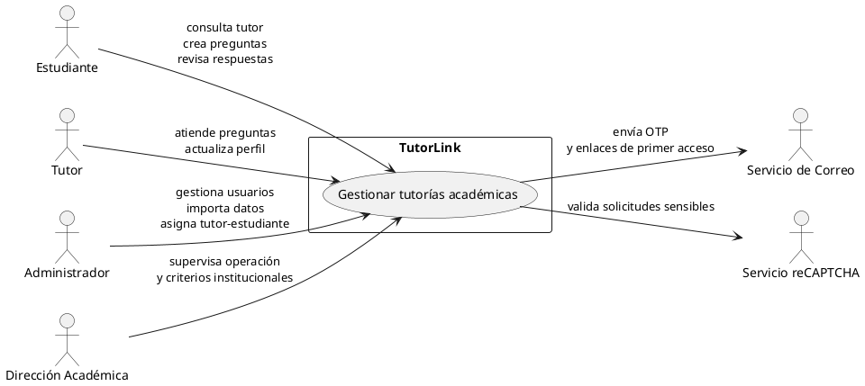
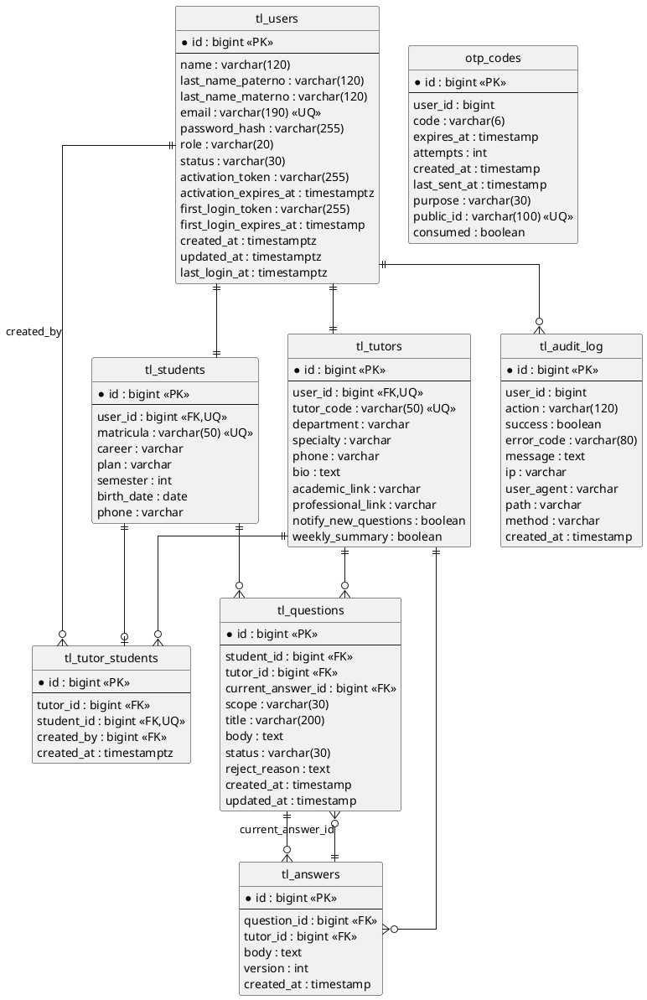
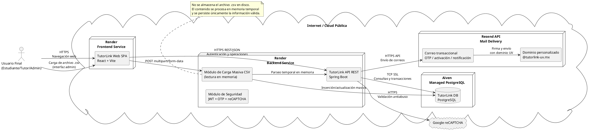

# Especificación de Requisitos: TutorLink

## HOJA DE CONTROL

| Campo | Valor |
| --- | --- |
| Documento | Especificación de Requisitos de Software (SRS) |
| Proyecto | TutorLink |
| Código documental | SRS-TL-2026 |
| Versión actual | 0100 |
| Fecha base | 2026-04-01 |
| Estado | Borrador controlado |
| Elaborado por | Análisis de Sistemas / Arquitectura de Software |
| Revisado por | Project Manager / Líder Técnico |
| Aprobado por | Patrocinador funcional / Dirección académica |

## REGISTRO DE CAMBIOS

| Versión | Fecha | Descripción del cambio | Responsable |
| --- | --- | --- | --- |
| 0100 | 2026-04-01 | Emisión inicial del SRS a partir del código fuente, arquitectura y documentación de TutorLink | Analista de Sistemas / Arquitecto de Software |

## CONTROL DE DISTRIBUCIÓN

| Copia / Destinatario | Área | Medio | Responsable de custodia |
| --- | --- | --- | --- |
| Dirección académica | Negocio | Repositorio documental | Project Manager |
| Equipo de desarrollo | Tecnología | Repositorio Git / documentación | Líder técnico |
| QA / pruebas | Calidad | Repositorio documental | Responsable QA |
| Operación / soporte | Infraestructura | Repositorio documental | Responsable de soporte |

## 1. INTRODUCCIÓN

TutorLink surge para resolver la gestión fragmentada de tutorías académicas universitarias, donde las interacciones entre estudiantes, tutores y administración suelen depender de correo informal, mensajería aislada o procesos manuales con baja trazabilidad. Esta situación provoca tiempos de respuesta variables, dificultad para controlar asignaciones, poca visibilidad institucional y riesgo operativo en el seguimiento académico.

El sistema responde a esa necesidad mediante una plataforma web institucional con control por roles, autenticación reforzada, asignación formal tutor-estudiante, gestión de preguntas académicas y auditoría de eventos relevantes. La especificación presente formaliza los requisitos funcionales, no funcionales, estructuras de datos, casos de uso y la arquitectura técnica identificada en el repositorio del proyecto.

### 1.1 Alcance

La solución impacta a los siguientes actores y elementos organizativos:

- Dirección o coordinación académica, como interesada en la trazabilidad y control del proceso de tutorías.
- Administradores institucionales, responsables de altas, estados, importaciones y asignaciones.
- Tutores académicos, responsables de atender consultas y mantener su perfil.
- Estudiantes, usuarios finales que consultan tutor asignado, crean preguntas y revisan respuestas.
- Equipo de soporte e infraestructura, que opera backend, base de datos, correo y configuración de ambientes.

El alcance de este SRS cubre el sistema TutorLink como producto software compuesto por frontend SPA, backend REST, persistencia relacional, autenticación con `JWT` y `OTP`, validación `reCAPTCHA`, auditoría y servicios de correo.

### 1.2 Objetivos

Los objetivos principales del sistema en producción son:

- Centralizar la interacción académica entre estudiante y tutor en una única plataforma institucional.
- Permitir administración controlada de usuarios `ADMIN`, `TUTOR` y `ESTUDIANTE`.
- Habilitar la asignación formal de estudiantes a tutores y su consulta por parte del estudiante.
- Permitir al estudiante registrar preguntas académicas y consultar el historial de respuestas.
- Permitir al tutor responder, corregir, rechazar o reclasificar preguntas asignadas.
- Reforzar la seguridad de acceso mediante credenciales, `OTP`, primer acceso y validación `reCAPTCHA`.
- Mantener trazabilidad operativa a través de auditoría de eventos relevantes de acceso y operación.

## 2. DESCRIPCIÓN DEL PROYECTO

TutorLink es una plataforma web institucional para gestión de tutorías académicas en contexto universitario. Desde el punto de vista técnico, se implementa como una arquitectura cliente-servidor desacoplada con:

- frontend SPA en `React 19 + Vite`;
- backend API REST en `Spring Boot 3.3.4`;
- base de datos `PostgreSQL`;
- autenticación `JWT` + `OTP`;
- integración con correo y `reCAPTCHA`.

El problema central que resuelve es la ausencia de una plataforma formal para administrar usuarios, asignaciones, consultas académicas y seguimiento auditable de la relación tutor-estudiante.

Los módulos principales identificados son:

- autenticación y acceso;
- administración de usuarios;
- perfiles e identidad;
- asignación tutor-estudiante;
- preguntas del estudiante;
- atención de preguntas del tutor;
- dashboards y consultas operativas;
- seguridad, validación pública y auditoría.

### 2.1 Requerimientos y/o restricciones

La siguiente tabla resume requisitos clave, expresados con estructura compatible con `IEEE 830` y derivados del código real del sistema:

| ID | Nombre | Versión | Dependencias | Descripción | Requisitos hijos | Importancia | Prioridad | Estado | Comentarios |
| --- | --- | --- | --- | --- | --- | --- | --- | --- | --- |
| RF-001 | Registro y activación de usuarios | 0100 | `AuthController`, `User`, `RecaptchaService`, `AgeValidator` | El sistema debe permitir registrar usuarios en flujo público y activar cuentas creadas por administración mediante token o primer acceso | RF-001.1 validación de reCAPTCHA; RF-001.2 validación de edad; RF-001.3 unicidad de correo | Alta | Alta | Identificado | El registro público existe en backend; el flujo administrativo usa primer login |
| RF-002 | Autenticación con OTP | 0100 | `AuthController`, `OtpService`, `JwtService`, correo | El sistema debe autenticar usuarios con correo y contraseña y exigir OTP para completar el acceso | RF-002.1 emisión OTP; RF-002.2 expiración; RF-002.3 límite de intentos | Crítica | Alta | Identificado | Flujo central de seguridad |
| RF-003 | Gestión de usuarios por administrador | 0100 | `AdminUserController`, `AdminUserService`, `User`, `Student`, `Tutor` | El sistema debe permitir al administrador crear, editar, listar e inhabilitar usuarios | RF-003.1 estudiantes; RF-003.2 tutores; RF-003.3 administradores; RF-003.4 cambio de estado | Alta | Alta | Identificado | Requisito nuclear del módulo administrativo |
| RF-004 | Importación masiva por CSV | 0100 | `AdminUserController`, `AdminUserService` | El sistema debe permitir importar estudiantes, tutores y asignaciones mediante texto CSV validado | RF-004.1 importación de estudiantes; RF-004.2 importación de tutores; RF-004.3 importación de asignaciones | Media | Media | Identificado | Reduce carga administrativa |
| RF-005 | Asignación tutor-estudiante | 0100 | `TutorStudent`, `AdminUserController`, `TutorStudentRepository` | El sistema debe permitir asignar un estudiante a un tutor y mantener una única asignación activa por estudiante | RF-005.1 alta; RF-005.2 consulta; RF-005.3 eliminación; RF-005.4 sugerencias de no asignados | Alta | Alta | Identificado | La asignación puede registrar el administrador creador |
| RF-006 | Consulta de tutor asignado | 0100 | `StudentController`, `TutorStudentRepository` | El sistema debe permitir al estudiante consultar su tutor asignado con datos de contacto académico básicos | RF-006.1 nombre; RF-006.2 código; RF-006.3 departamento; RF-006.4 correo | Alta | Alta | Identificado | Punto de contacto del estudiante |
| RF-007 | Creación y consulta de preguntas académicas | 0100 | `StudentController`, `QaService`, `Question`, `Answer` | El sistema debe permitir al estudiante crear preguntas y consultar detalle e historial de respuestas | RF-007.1 validación reCAPTCHA; RF-007.2 paginación; RF-007.3 historial | Alta | Alta | Identificado | Requisito funcional principal del lado estudiante |
| RF-008 | Atención de preguntas por tutor | 0100 | `TutorController`, `QaService`, `Answer`, `Question` | El sistema debe permitir al tutor responder, corregir, rechazar o reclasificar preguntas asignadas | RF-008.1 responder; RF-008.2 corregir; RF-008.3 rechazar; RF-008.4 reclasificar | Crítica | Alta | Identificado | Núcleo de la operación de tutoría |
| RF-009 | Dashboard y consultas por rol | 0100 | `TutorController`, frontend SPA, DTOs de dashboard | El sistema debe presentar paneles y listados diferenciados por rol, mostrando información operativa relevante | RF-009.1 dashboard admin; RF-009.2 dashboard tutor; RF-009.3 consultas paginadas de estudiante | Media | Media | Identificado | Requisito de visibilidad operativa |
| RF-010 | Perfil del tutor | 0100 | `TutorController`, `Tutor`, `TutorProfileDto` | El sistema debe permitir al tutor consultar y actualizar bio, enlaces y preferencias de notificación | RF-010.1 lectura; RF-010.2 actualización | Media | Media | Identificado | Requisito específico del rol tutor |
| RNF-011 | Seguridad por roles | 0100 | `SecurityConfig`, `JwtAuthFilter`, rutas protegidas | El sistema debe restringir acceso por rol a rutas y endpoints, evitando exposición de funciones no autorizadas | RNF-011.1 autorización backend; RNF-011.2 guards frontend | Crítica | Alta | Identificado | Control técnico transversal |
| RNF-012 | Persistencia relacional controlada | 0100 | `PostgreSQL`, `JPA`, `Flyway` | El sistema debe operar sobre base relacional con esquema versionado y relaciones consistentes | RNF-012.1 integridad; RNF-012.2 migraciones; RNF-012.3 unicidad de claves | Alta | Alta | Identificado | Base de la integridad del dominio |

Restricciones técnicas y de infraestructura identificadas:

- El backend debe ejecutarse sobre `Java 17` y `Spring Boot 3.3.4`.
- La persistencia depende de `PostgreSQL`.
- El esquema evoluciona mediante `Flyway`, aunque en configuración actual coexiste con `ddl-auto: update`.
- La seguridad depende de `JWT`, `OTP`, `reCAPTCHA` y servicio de correo.
- El frontend real del repositorio es `React + Vite`; no existe implementación en `Angular`.
- La URL del frontend y la API base son configurables por variables de entorno, con dependencia de despliegue por ambiente.

## 3. DIAGRAMA DE CONTEXTO



## 4. MODELADO DE BD CON SU DICCIONARIO DE DATOS

### 4.1 Modelo Entidad-Relación



### 4.2 Diccionario de Datos

| Tabla | Propósito | Clave primaria | Campos relevantes | Relaciones principales |
| --- | --- | --- | --- | --- |
| `tl_users` | Identidad base del sistema | `id` | nombre, apellidos, email, hash de contraseña, rol, estado, tokens de activación y primer login | 1:1 con `tl_students` y `tl_tutors`; 1:N con `tl_audit_log`; referencia como creador en `tl_tutor_students` |
| `tl_students` | Perfil académico del estudiante | `id` | `matricula`, carrera, plan, semestre, fecha de nacimiento, teléfono | 1:1 con `tl_users`; 1:N con `tl_questions`; 1:1 funcional con `tl_tutor_students` |
| `tl_tutors` | Perfil académico/profesional del tutor | `id` | `tutor_code`, departamento, especialidad, teléfono, bio, enlaces, preferencias | 1:1 con `tl_users`; 1:N con `tl_tutor_students`, `tl_questions` y `tl_answers` |
| `tl_tutor_students` | Asignación operativa tutor-estudiante | `id` | tutor, estudiante, creador, fecha de asignación | N:1 hacia `tl_tutors`; N:1 hacia `tl_students`; N:1 hacia `tl_users` como creador |
| `tl_questions` | Preguntas académicas del estudiante | `id` | alcance (`scope`), título, cuerpo, estado, motivo de rechazo, respuesta vigente | N:1 hacia `tl_students`; N:1 hacia `tl_tutors`; 1:N con `tl_answers` |
| `tl_answers` | Historial de respuestas y correcciones | `id` | pregunta, tutor, cuerpo, versión, fecha | N:1 hacia `tl_questions`; N:1 hacia `tl_tutors` |
| `otp_codes` | Persistencia de OTP para login y cambio de contraseña | `id` | `user_id`, código, expiración, intentos, propósito, `public_id`, consumo | Relación lógica con `tl_users` por `user_id` |
| `tl_audit_log` | Auditoría técnica y funcional | `id` | acción, éxito, error, mensaje, IP, user-agent, path, método, fecha | Relación lógica con `tl_users` por `user_id` |

### 4.3 Script SQL básico

```sql
CREATE TABLE tl_users (
  id BIGSERIAL PRIMARY KEY,
  name VARCHAR(120) NOT NULL,
  last_name_paterno VARCHAR(120) NOT NULL,
  last_name_materno VARCHAR(120),
  email VARCHAR(190) NOT NULL UNIQUE,
  password_hash VARCHAR(255) NOT NULL,
  role VARCHAR(20) NOT NULL,
  status VARCHAR(30) NOT NULL,
  activation_token VARCHAR(255),
  activation_expires_at TIMESTAMPTZ,
  first_login_token VARCHAR(255),
  first_login_expires_at TIMESTAMP,
  created_at TIMESTAMPTZ NOT NULL,
  updated_at TIMESTAMPTZ NOT NULL,
  last_login_at TIMESTAMPTZ
);

CREATE TABLE tl_students (
  id BIGSERIAL PRIMARY KEY,
  user_id BIGINT NOT NULL UNIQUE REFERENCES tl_users(id),
  matricula VARCHAR(50) NOT NULL UNIQUE,
  career VARCHAR(255),
  plan VARCHAR(255),
  semester INTEGER,
  birth_date DATE,
  phone VARCHAR(255)
);

CREATE TABLE tl_tutors (
  id BIGSERIAL PRIMARY KEY,
  user_id BIGINT NOT NULL UNIQUE REFERENCES tl_users(id),
  tutor_code VARCHAR(50) NOT NULL UNIQUE,
  department VARCHAR(255),
  specialty VARCHAR(255),
  phone VARCHAR(255),
  bio TEXT,
  academic_link VARCHAR(255),
  professional_link VARCHAR(255),
  notify_new_questions BOOLEAN NOT NULL DEFAULT FALSE,
  weekly_summary BOOLEAN NOT NULL DEFAULT FALSE
);

CREATE TABLE tl_tutor_students (
  id BIGSERIAL PRIMARY KEY,
  tutor_id BIGINT NOT NULL REFERENCES tl_tutors(id),
  student_id BIGINT NOT NULL UNIQUE REFERENCES tl_students(id),
  created_by BIGINT REFERENCES tl_users(id),
  created_at TIMESTAMPTZ NOT NULL
);

CREATE TABLE tl_questions (
  id BIGSERIAL PRIMARY KEY,
  student_id BIGINT NOT NULL REFERENCES tl_students(id),
  tutor_id BIGINT REFERENCES tl_tutors(id),
  scope VARCHAR(30) NOT NULL,
  title VARCHAR(200) NOT NULL,
  body TEXT NOT NULL,
  status VARCHAR(30) NOT NULL,
  reject_reason TEXT,
  current_answer_id BIGINT,
  created_at TIMESTAMP,
  updated_at TIMESTAMP
);

CREATE TABLE tl_answers (
  id BIGSERIAL PRIMARY KEY,
  question_id BIGINT NOT NULL REFERENCES tl_questions(id),
  tutor_id BIGINT NOT NULL REFERENCES tl_tutors(id),
  body TEXT NOT NULL,
  version INTEGER NOT NULL,
  created_at TIMESTAMP
);

ALTER TABLE tl_questions
ADD CONSTRAINT fk_questions_current_answer
FOREIGN KEY (current_answer_id) REFERENCES tl_answers(id);

CREATE TABLE otp_codes (
  id BIGSERIAL PRIMARY KEY,
  user_id BIGINT NOT NULL,
  code VARCHAR(6) NOT NULL,
  expires_at TIMESTAMP NOT NULL,
  attempts INTEGER NOT NULL,
  created_at TIMESTAMP NOT NULL,
  last_sent_at TIMESTAMP,
  purpose VARCHAR(30) NOT NULL,
  public_id VARCHAR(100) NOT NULL UNIQUE,
  consumed BOOLEAN NOT NULL
);

CREATE TABLE tl_audit_log (
  id BIGSERIAL PRIMARY KEY,
  user_id BIGINT,
  action VARCHAR(120) NOT NULL,
  success BOOLEAN NOT NULL,
  error_code VARCHAR(80),
  message TEXT,
  ip VARCHAR(255),
  user_agent VARCHAR(255),
  path VARCHAR(255),
  method VARCHAR(20),
  created_at TIMESTAMP
);
```

## 5. DIAGRAMAS DE CASO DE USO

### 5.1 Diagramas de casos de uso

La concepción funcional original de TutorLink, basada en tutorías universitarias para una sola institución, se conserva como base del sistema actual. Sin embargo, a partir del análisis del repositorio y de la nueva dirección del producto, los casos de uso se reinterpretan bajo un modelo multiinstitución licenciable.

Los nuevos diagramas distinguen claramente entre:

- funcionalidades implementadas actualmente en el código (`autenticación`, administración de usuarios, asignación tutor-estudiante, preguntas académicas, paneles y perfil del tutor);
- capacidades conceptuales de evolución del producto (espacios institucionales, clases, tareas, asistencia, seguimiento, notificaciones y alertas preventivas);
- procesos automáticos del sistema, separados de las acciones ejecutadas directamente por los usuarios.

#### 5.1.1 Plataforma multiinstitución y licenciamiento

Archivo fuente: [diagramas/casos-uso-plataforma-multinstitucion.puml](</home/sinoe/Respaldo_Debian (2)/TUTORLINK/diagramas/casos-uso-plataforma-multinstitucion.puml>)

Este diagrama introduce los actores `Administrador general TutorLink` y `Administrador de institución`, manteniendo la autenticación reforzada ya existente y agregando la gestión de licencias, espacios institucionales, personalización visual y separación lógica entre instituciones.

#### 5.1.2 Operación académica por rol

Archivo fuente: [diagramas/03_casos-uso-clases-tareas-entregas.puml](</home/sinoe/Respaldo_Debian (2)/TUTORLINK/diagramas/03_casos-uso-clases-tareas-entregas.puml>)

Este diagrama conserva el núcleo funcional identificado en el sistema actual:

- el estudiante consulta tutor asignado, crea preguntas y revisa historial;
- el tutor académico atiende preguntas, corrige, rechaza, reclasifica y mantiene su perfil;
- el administrador institucional conserva gestión operativa y visibilidad;
- el docente incorpora el nuevo módulo de clases, tareas y seguimiento de entregas.

#### 5.1.3 Seguimiento, asistencia, notificaciones y alertas

Archivo fuente: [diagramas/04_casos-uso-notificaciones-alertas.puml](</home/sinoe/Respaldo_Debian (2)/TUTORLINK/diagramas/04_casos-uso-notificaciones-alertas.puml>)

Este diagrama agrega los mecanismos de seguimiento preventivo solicitados:

- control de asistencia;
- consulta de progreso por estudiante, docente, tutor y administrador institucional;
- recordatorios y cierres automáticos de tareas;
- alertas académicas configurables por inasistencias o tareas no entregadas;
- participación acotada de padre, madre o tutor legal según reglas de acceso permitidas.

### 5.2 Especificación de 3 casos de uso críticos

#### CU-001 Iniciar sesión con OTP

| Campo | Valor |
| --- | --- |
| ID | CU-001 |
| Nombre | Iniciar sesión con OTP |
| Versión | 0100 |
| Dependencias | `AuthController`, `OtpService`, `JwtService`, `RecaptchaService`, correo |
| Precondición | El usuario existe, tiene cuenta habilitada y acceso a su correo institucional |
| Descripción | Permite autenticarse con correo y contraseña, validar `reCAPTCHA`, recibir OTP y completar el acceso con token JWT |
| Secuencia Normal (Paso/Acción) | 1. El usuario ingresa correo y contraseña. 2. El sistema valida `reCAPTCHA`. 3. El sistema valida credenciales y estado del usuario. 4. El sistema genera OTP y lo envía por correo. 5. El usuario captura OTP. 6. El sistema valida OTP. 7. El sistema emite JWT y redirige al dashboard según rol. |
| Postcondición | El usuario queda autenticado y autorizado según su rol |
| Excepciones | `reCAPTCHA` inválido, credenciales inválidas, usuario no activo, OTP expirado, OTP consumido, exceso de intentos, falla de correo |
| Rendimiento | El login inicial debe responder en tiempo compatible con operación web; el cuello principal es envío de OTP |
| Frecuencia | Alta |
| Importancia | Crítica |
| Prioridad | Alta |
| Estado | Identificado |
| Comentarios | Es el punto de entrada de todos los roles |

#### CU-002 Asignar estudiante a tutor

| Campo | Valor |
| --- | --- |
| ID | CU-002 |
| Nombre | Asignar estudiante a tutor |
| Versión | 0100 |
| Dependencias | `AdminUserController`, `AdminUserService`, `TutorStudent`, `Student`, `Tutor`, `User` |
| Precondición | El administrador está autenticado; existen estudiante y tutor válidos |
| Descripción | Permite crear o reemplazar la relación operativa entre un estudiante y un tutor, registrando quién realizó la asignación |
| Secuencia Normal (Paso/Acción) | 1. El administrador selecciona tutor y estudiante. 2. El sistema valida existencia de ambos. 3. El sistema verifica unicidad de asignación por estudiante. 4. Si existe asignación previa, la reemplaza conforme a la lógica definida. 5. El sistema guarda la nueva relación. 6. El sistema confirma la operación. |
| Postcondición | El estudiante queda asociado a un único tutor vigente |
| Excepciones | Tutor inexistente, estudiante inexistente, datos inválidos, error de persistencia, conflicto de integridad |
| Rendimiento | Operación transaccional de baja latencia esperada |
| Frecuencia | Media |
| Importancia | Alta |
| Prioridad | Alta |
| Estado | Identificado |
| Comentarios | Impacta toda la operación de preguntas y consulta de tutor asignado |

#### CU-003 Atender pregunta académica

| Campo | Valor |
| --- | --- |
| ID | CU-003 |
| Nombre | Atender pregunta académica |
| Versión | 0100 |
| Dependencias | `TutorController`, `QaService`, `Question`, `Answer`, `Tutor` |
| Precondición | El tutor está autenticado y la pregunta está disponible dentro de su ámbito operativo |
| Descripción | Permite al tutor responder, corregir, rechazar o reclasificar una pregunta académica generada por un estudiante |
| Secuencia Normal (Paso/Acción) | 1. El tutor consulta pendientes. 2. El sistema lista preguntas aplicables. 3. El tutor abre una pregunta. 4. El tutor decide responder, corregir, rechazar o reclasificar. 5. El sistema registra la acción y actualiza estado. 6. El historial queda disponible para consulta. |
| Postcondición | La pregunta cambia de estado y queda trazabilidad de la acción realizada |
| Excepciones | Pregunta inexistente, tutor no autorizado, datos inválidos, error de persistencia, inconsistencia de estado |
| Rendimiento | Debe responder en tiempo compatible con navegación web; la consulta de historial puede crecer según volumen |
| Frecuencia | Alta |
| Importancia | Crítica |
| Prioridad | Alta |
| Estado | Identificado |
| Comentarios | Caso de uso central del rol tutor |

## 6. ESPECIFICACIÓN TÉCNICA

### 6.1 Tecnologías utilizadas

| Componente | Tecnología | Versión identificada | Observaciones |
| --- | --- | --- | --- |
| Entorno institucional objetivo | Universidad Veracruzana (UV) | Operación cloud administrada | Implementación orientada a disponibilidad, trazabilidad y seguridad de datos académicos |
| IDE de desarrollo | VS Code / IntelliJ IDEA | No fijada en código | Herramientas de trabajo del equipo frontend y backend |
| Frontend (producción) | React | `19.2.0` | Aplicación SPA desplegada en servicio web estático de Render |
| Bundler frontend | Vite | `7.2.4` | Compilación y empaquetado del cliente web |
| Enrutamiento frontend | React Router DOM | `7.10.1` | Navegación por rol y protección de rutas |
| Cliente HTTP frontend | Axios | `1.13.2` | Consumo de API REST con tokens JWT |
| Estilos frontend | Tailwind CSS | `3.4.10` | Capa visual y utilidades de estilos |
| Backend (producción) | Spring Boot | `3.3.4` | API REST desplegada en Render (servicio web) |
| Lenguaje backend | Java | `17` | Runtime principal del servidor |
| Seguridad backend | Spring Security + JWT + OTP + reCAPTCHA | `3.3.4` + `jjwt 0.11.5` | Control de autenticación, autorización y protección antiabuso |
| Persistencia | Spring Data JPA / Hibernate | Incluida en Spring Boot | Capa ORM y acceso al modelo relacional |
| Base de datos (producción) | PostgreSQL gestionado en Aiven | Servicio administrado | Persistencia transaccional y operación administrada |
| Migraciones de esquema | Flyway | Dependencia presente | Versionado y trazabilidad de cambios de base de datos |
| Servicio de correos | Resend API | SDK Java `4.11.0` | Envío de OTP, activación y notificaciones con dominio `tutorlink-uv.mx` |
| Procesamiento de archivos masivos | Lectura temporal de CSV en memoria | N/A | Importación de usuarios desde `.csv` sin almacenamiento persistente de archivos físicos |

Arquitectura de despliegue en producción para UV:

- El frontend React se publica en `Render` y consume la API sobre HTTPS.
- El backend Spring Boot se ejecuta en `Render`, expone endpoints REST y centraliza reglas de negocio.
- La base de datos vive en `Aiven PostgreSQL`, con acceso restringido desde backend por credenciales seguras.
- Las notificaciones y OTP se envían vía `Resend API` con dominio institucional `tutorlink-uv.mx`.
- Las cargas masivas `.csv` se parsean en memoria del backend y se persisten directamente en PostgreSQL, sin guardar archivos en disco del servidor.

### 6.2 Diagrama de Arquitectura



## 7. ANEXOS

### 7.1 Anexo A: Actas de Reuniones

Pendiente de incorporación en versión posterior del documento.

### 7.2 Anexo B: Documentación Relevante

Pendiente de incorporación en versión posterior del documento.

### 7.3 Anexo C: Glosario de Acrónimos y Abreviaturas

| Término | Definición |
| --- | --- |
| API | Application Programming Interface |
| CSV | Comma-Separated Values |
| DTO | Data Transfer Object |
| ERD | Entity Relationship Diagram |
| HTTP | Hypertext Transfer Protocol |
| IDE | Integrated Development Environment |
| JPA | Jakarta Persistence API |
| JWT | JSON Web Token |
| OTP | One-Time Password |
| QA | Quality Assurance |
| REST | Representational State Transfer |
| SPA | Single Page Application |
| SRS | Software Requirements Specification |
| SQL | Structured Query Language |
| UML | Unified Modeling Language |
